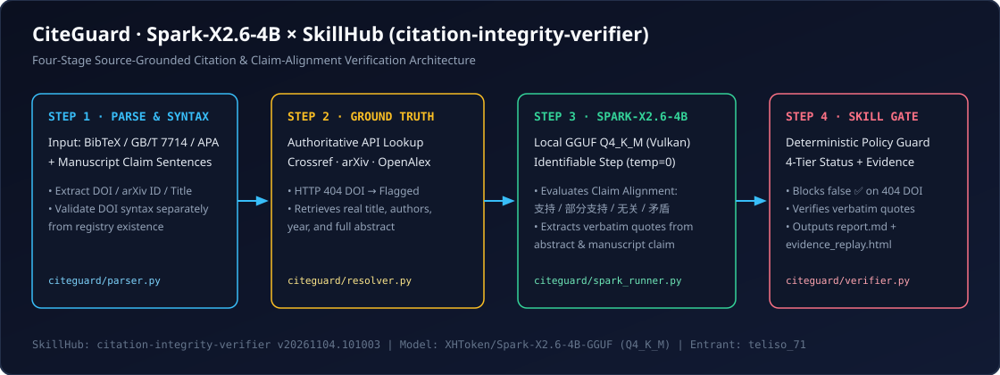

# CiteGuard · Academic Citation Integrity & Claim-Alignment Verifier

> **HER Hack-Astron #8 (Spark × SkillHub Agent Skills Challenge)** 参赛工程  
> SkillHub 技能：[`citation-integrity-verifier`](https://skill.xfyun.cn/) (`v20261104.101003`) · 本地模型：`XHToken/Spark-X2.6-4B-GGUF` (`Spark-X2.6-4B-Q4_K_M.gguf`)  
> 参赛署名：`teliso_71`



## 1. 解决什么问题？
在 LLM 辅助学术写作与审稿场景中，最隐蔽的风险不是语法错误，而是两类「引用幻觉」：
1. **伪造或张冠李戴的参考文献**：格式看似合法的 DOI（如 `10.1145/9999999.8888888`）实际在 Crossref 未注册，或将 A 论文的作者/年份套到 B 论文上；
2. **声明-引用不对齐（Claim Misalignment）**：文献真实存在，但正文引用该文献支撑的结论与摘要/原文相矛盾（或过度夸大）。

**CiteGuard** 将 SkillHub 的 `citation-integrity-verifier` 规范落成确定性代码门控 + 本地 `Spark-X2.6-4B` 语义核对流水线，绝不让小模型凭记忆猜 DOI，也绝不无条件相信模型输出的引用片段。

## 2. 技能、检索与模型分工
1. **SkillHub 技能 (`citation-integrity-verifier v20261104.101003`)**：定义 4 级状态体系（`✅ 已核验存在 / ⚠️ 存疑 / ❌ 疑似编造 / ⬜ 无法核验`）、DOI 语法与存在性分离校验、4 级声明对齐（`支持 / 部分支持 / 无关 / 矛盾`）、不直接定性「学术不端」、不改写原列表等红线。
2. **确定性解析与检索层 (`citeguard/parser.py`, `citeguard/resolver.py`)**：解析 BibTeX / GB/T 7714 / APA / 编号列表，调用 Crossref / arXiv / OpenAlex 公开 API 拉取权威题录与摘要（支持本地 JSON 快照复现）。
3. **本地 `Spark-X2.6-4B-Q4_K_M` 执行的核心步骤 (`citeguard/spark_runner.py`)**：读取 `[CITED_ENTRY] + [MANUSCRIPT_CLAIM] + [RETRIEVED_GROUND_TRUTH]`，以 `temperature=0, reasoning=off` 输出严格 JSON，判定声明对齐关系并逐字摘录正文与文献摘要中的依据片段（`evidence_quote` / `claim_quote`）。
4. **反幻觉确定性门控 (`citeguard/verifier.py`)**：
   - 若 DOI 在 Crossref 返回 `404`，强制判为 `❌ 疑似编造` 并拦截任何虚假「支持」结论；
   - 自动比对标题相似度、作者姓氏交集与年份，不一致时强制降级为 `⚠️ 存疑`；
   - 校验 Spark 返回的 `evidence_quote` 是否真正在检索摘要/标题中逐字出现，未命中则标为未核实并触发人工复核提示。

## 3. 快速复现与测试
```bash
# 0. 可选：以可编辑模式安装（仅依赖 Python >= 3.10 标准库，零第三方依赖）
pip install -e .

# 1. 运行确定性单元测试与离线 CLI 冒烟测试（无需模型与外网）
python -m unittest discover -s tests -v

# 2. 运行离线确定性门控流水线（使用缓存题录快照）
python -m citeguard.cli --input benchmarks/sample_manuscript.json --out-dir artifacts_dryrun --cache benchmarks/ground_truth_cache.json --offline --skip-spark

# 3. 运行完整本地 Spark-X2.6-4B 核验流水线（默认自动启动 llama-server.exe）
python -m citeguard.cli --input benchmarks/sample_manuscript.json --out-dir artifacts --cache benchmarks/ground_truth_cache.json
```

## 4. 参赛材料与自动化 CI
- 完整参赛展示说明：[`SUBMISSION_HF.md`](./SUBMISSION_HF.md)
- GitHub Actions 自动化验证：`.github/workflows/ci.yml`（Python 3.10–3.12 单元测试 + 10 条基准离线冒烟）
