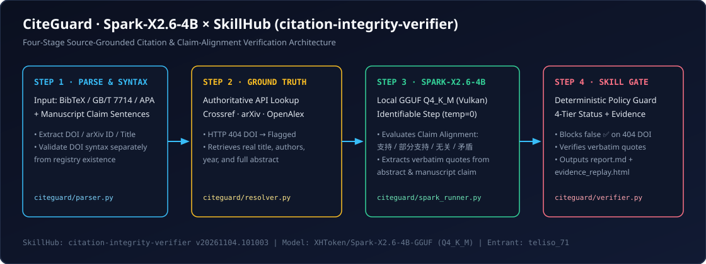
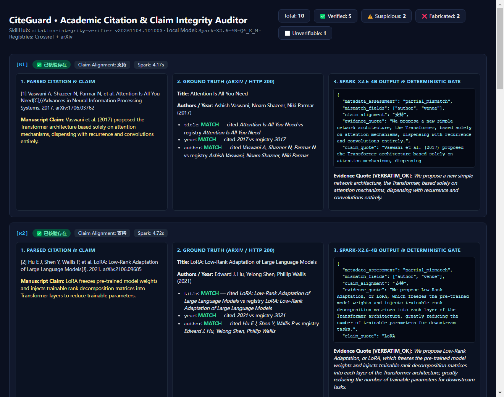
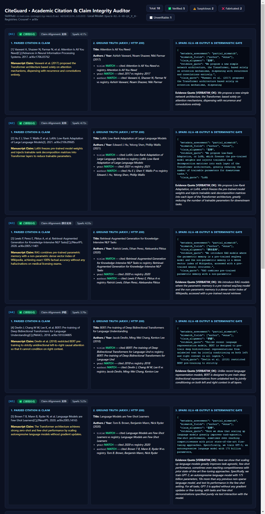

# [HER Hack-Astron #8] [Spark × SkillHub] CiteGuard：零幻觉学术引用核验与声明对齐台

## 作品名称与方向
- **作品名称**：CiteGuard — 学术引用真实性与声明对齐核验台（Source-Grounded Citation & Claim Integrity Auditor）
- **参赛方向**：文档与信息提取 / 科研与开发者工具（Open Track / Documents and extraction）

## 用户与任务
- **目标用户**：论文作者（投稿前参考文献自查）、期刊审稿人/编辑、文献综述写作者与导师。
- **解决什么问题**：LLM 辅助写作时代常出现两类隐蔽引用错误——(1) **编造或张冠李戴的题录/DOI**（格式完全合法但未注册，或将 A 论文作者/年份张冠李戴到 B 论文）；(2) **声明-引用不对齐**（文献存在，但正文声称的结论与原文献摘要相矛盾或被过度夸大）。
- **示例输入与事先确定的验收标准**：
  - 预设 10 条基准测试集（`benchmarks/sample_manuscript.json`，在运行本地推理前确定黄金标签）：涵盖 5 条真实 arXiv/NeurIPS/NAACL 引文（分别对应「支持」「部分支持」「矛盾」三种对齐关系）、2 条作者/年份张冠李戴引文、2 条格式合法但 Crossref 未注册（HTTP 404）的 LLM 编造 DOI、1 条无公开元数据的内部中文技术报告（无正文声明）。
  - 验收标准（对齐 SkillHub `citation-integrity-verifier`）：(1) 绝不凭大模型记忆猜 DOI，DOI 语法校验与注册库存在性分离；(2) 404/未注册 DOI 禁止被模型误判为 `✅ 已核验存在` 或 `支持`；(3) 模型输出的原文证据片段（`evidence_quote`）必须逐字命中检索到的权威题录/摘要；(4) 不提供正文时强制标为 `未提供正文`；(5) 不越权下「学术不端」定性结论。

## SkillHub 技能与 Spark-X2.6-4B
- **技能名称、详情链接、来源与版本**：
  - 名称：`citation-integrity-verifier`（学术引用真实性核验与声明对齐检查）
  - 详情页：[https://skill.xfyun.cn/](https://skill.xfyun.cn/)（slug: `citation-integrity-verifier`）
  - 版本：`v20261104.101003` · 下载包 SHA-256：`4ed17531df9ae73226dbb791397f9d744f6eefc98cd186e1bbca197de1be1481`
- **Agent 宿主、技能指导的步骤**：
  - 技能 `SKILL.md` 规定了四步标准工作流：**① 解析与规范化（含 DOI 语法独立校验）→ ② 按标识符/题录分级存在性核验与检索范围声明 → ③ 声明-引用四级对齐（支持 / 部分支持 / 无关 / 矛盾）与逐字证据引用 → ④ 输出统计摘要、差异明细、待作者自行核验的修复建议及人工定性边界**。
- **模型来源、revision、Spark 实际执行的步骤**：
  - 模型：`XHToken/Spark-X2.6-4B-GGUF`（`Spark-X2.6-4B-Q4_K_M.gguf`，3,543,441,312 字节）
  - HF Revision：`9d716770ac7477776de5f891f70cdf98b003a5cd`
  - **Spark 实际执行的单一明确步骤**（`citeguard/spark_runner.py`）：接收确定性模块提取出的 `[CITED_ENTRY]` + `[MANUSCRIPT_CLAIM]` + Crossref/arXiv 真实检索得到的 `[RETRIEVED_GROUND_TRUTH]`，以 `temperature=0, seed=42, reasoning=off` 输出严格 JSON，完成字段一致性辅助判定、**声明-引用四级对齐分类**以及**逐字证据片段（`evidence_quote` / `claim_quote`）抽取**。
- **其他模型、工具或服务及其作用**：
  - **Crossref REST API / arXiv API / OpenAlex Works API**：提供权威元数据与真实摘要（禁止由模型凭参数记忆判断文献是否存在）；
  - **确定性反幻觉门控（`citeguard/verifier.py`）**：对 HTTP 404 DOI 强制锁死为 `❌ 疑似编造` 并拦截虚假支持；校验标题相似度/作者姓氏交集/年份，不一致时降级为 `⚠️ 存疑`；逐字校验 `evidence_quote` 是否真正在检索摘要中出现。

## Demo（图文 Walkthrough，必填）






**一次真实输入 → Spark 原始输出 → 最终产物 → 人工核对示例（R4 与 R8）**：
- **R4（文献真实存在但正文声明矛盾）**：
  - 输入引文：`[4] Devlin J, Chang M W, Lee K, et al. BERT: Pre-training of Deep Bidirectional Transformers for Language Understanding[C]//NAACL. 2018. arXiv:1810.04805`
  - 正文声明：`Devlin et al. (2018) restricted BERT pre-training to strictly unidirectional left-to-right causal attention so that it cannot condition on right context.`
  - Spark 原始输出：`claim_alignment: "矛盾"`, `evidence_quote: "Unlike recent language representation models, BERT is designed to pre-train deep bidirectional representations from unlabeled text by jointly conditioning on both left and right context in all layers."`（耗时 `3.76s`）
  - 确定性门控核对：`evidence_quote` 精确命中 arXiv 原文摘要（`VERBATIM_OK`），最终判定 **`✅ 已核验存在 · 对齐：矛盾`**。
- **R8（LLM 编造合法格式 DOI）**：
  - 输入引文：`[8] Chen X, Liu Y. Neural Symbolic Verification for Autonomous Agents[J]. Journal of Artificial Intelligence Research, 2024. doi:10.1145/9999999.8888888`
  - 检索依据：DOI 语法合法，但 Crossref 精确检索返回 `HTTP 404 (DOI not registered)`。
  - 最终产物：确定性门控阻断任何虚假支持，输出 **`❌ 疑似编造 · 对齐：无关`** 并标注幻觉特征「DOI 编号格式合法但 Crossref 未注册」，建议由作者核对或删除。

## 复现方式
- **硬件与运行时**：
  - GPU：NVIDIA GeForce RTX 4060 Laptop GPU (8GB VRAM)
  - 运行时：`llama.cpp` `b12671`（`llama-server.exe` Windows Vulkan x64）
  - 模型精度/量化：`Spark-X2.6-4B-Q4_K_M.gguf`（`-ngl 99 -c 4096 --reasoning off --reasoning-budget 0`）
  - 推理参数：`temperature=0.0`, `seed=42`, `max_tokens=512`
- **代码仓库与运行步骤**：
  - GitHub 公开仓库：[https://github.com/mizhouokayu-wq/citeguard-spark-skillhub](https://github.com/mizhouokayu-wq/citeguard-spark-skillhub)
  ```bash
  # 1. 运行 7 项确定性单元测试（无需模型与外网）
  python -m unittest discover -s tests -v

  # 2. 使用已缓存的真实 Crossref/arXiv 快照复现完整本地 Spark 推理与报告生成
  python -m citeguard.cli --input benchmarks/sample_manuscript.json --out-dir artifacts --cache benchmarks/ground_truth_cache.json --offline

  # 3. 定量评估
  python scripts/evaluate_benchmark.py
  ```

## 效果与局限
- **定量评估结果（10 条预设基准 × 完整本地运行）**：
  - 存在性/可信度四分类准确率：**10 / 10 (100.0%)**（`✅ 已核验存在` 5、`⚠️ 存疑` 2、`❌ 疑似编造` 2、`⬜ 无法核验` 1）
  - 声明-引用对齐准确率：**9 / 10 (90.0%)**
  - 原文逐字证据片段核验通过率：**7 / 7 (100.0%)**（Spark 输出的每一句 `evidence_quote` 均逐字命中检索摘要，零幻觉引用）
  - 平均单条 Spark 推理耗时：**3.71s**（1.92s – 5.23s，RTX 4060 Vulkan）
  - 无模型确定性单元测试：**7 / 7 通过**
- **诚实的失败样例与局限**：
  1. **R6 归因错位对齐误差（`部分支持` vs 预设 `矛盾`）**：R6 正文写的是「Touvron et al. (2023) introduced the Transformer architecture in Nature」并引用了 `arXiv:1706.03762`（Vaswani 等 2017）。Spark 在元数据层面正确识别了作者/年份/venue 不一致（最终状态判为 `⚠️ 存疑`），但在 `claim_alignment` 字段给出了 `部分支持`（因为它聚焦到「Transformer architecture」语义相符，未因正文句首的错误作者归因而判为 `矛盾`）。这说明 4B 模型在「内容一致但归因错误」的复合句子上仍需要与确定性元数据比对结果联合提醒人工复核。
  2. **检索边界**：当前仅接通 Crossref、arXiv 与 OpenAlex；中文期刊/内部报告（如 R10）在无 DOI 时超出现有英文/DOI 检索覆盖，会如实标为 `⬜ 无法核验`。
  3. **人工复核边界**：如 `SKILL.md` 所规定，本工具仅提供技术证据与疑点清单，绝不直接下「学术不端」定性结论。

## 贡献者与披露
- **参赛者**：个人参赛，`teliso_71`（GitHub: [@mizhouokayu-wq](https://github.com/mizhouokayu-wq) · Hugging Face: [@teliso-71](https://huggingface.co/teliso-71)）
- **AI 辅助开发方式**：本项目代码实现、单元测试、基准构造与本地运行报告整理均由 AI 编程助手协作完成；所有本地模型运行数据、API 返回快照与截图均在本地硬件真实执行验证。
- **数据、依赖来源与授权**：代码按 MIT/Apache-2.0 兼容开源；外部元数据来自 Crossref REST API、arXiv API 与 OpenAlex Works API 公开接口；SkillHub 技能来自 `iflytek/skillhub` 官方市场（`citation-integrity-verifier v20261104.101003`）。
